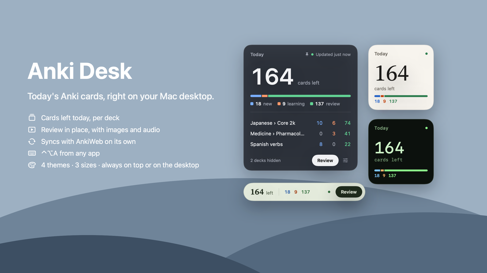

# Anki Desk

Today's Anki cards, right on your Mac desktop.



- Cards left today for the decks you pick, split into new, learning and review
- Review in place with images and audio; grades go to Anki's own scheduler
- Syncs with AnkiWeb on a timer, through Anki
- Drag it anywhere; keep it on top, as a normal window, or on the desktop
- ⌃⌥A shows or hides it from any app
- 4 themes, 3 sizes, count in the menu bar

## Setup

1. In Anki, install [AnkiConnect](https://ankiweb.net/shared/info/2055492159) (Tools › Add-ons › Get Add-ons, code `2055492159`) and restart Anki.
2. Build and run (macOS 14+, Xcode 16+, [XcodeGen](https://github.com/yonaskolb/XcodeGen)):

```bash
xcodegen generate
xcodebuild -project AnkiDesk.xcodeproj -scheme AnkiDesk -configuration Release -derivedDataPath build build
open build/Build/Products/Release/AnkiDesk.app
```

Keep Anki open in the background. There's no account: Anki Desk talks to Anki on `127.0.0.1:8765`.
The menu bar icon has Settings and a How to Use guide.

## License

[MIT](LICENSE)
